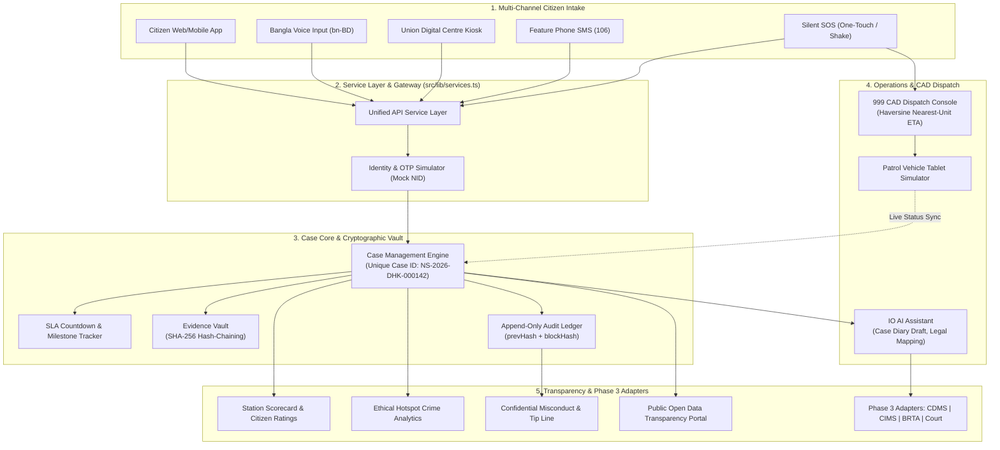

# NyayaSetu (ন্যায়সেতু) – Unified "Citizen-to-Case" Justice Platform

> **"প্রতিটি অভিযোগ, একটি ট্র্যাকযোগ্য কেস আইডি" / "Every complaint, one trackable case ID"**  
> A unified digital justice and police case-management platform designed for Bangladesh law enforcement, bridging citizens, police stations, Investigating Officers (IOs), evidence rooms, 999 emergency dispatch, and the judicial system.

[]()
[]()
[]()
[]()
[]()

---

## 1. Executive Summary

In traditional policing workflows, citizen complaints (General Diaries, emergency 999 calls, walk-in FIRs, cyber harassment reports) often enter through disconnected channels. Records remain fragmented, citizens struggle to track progress without visiting physical police stations, physical evidence custody lacks transparent cryptographic audit trails, and emergency dispatch suffers from relay delays.

**NyayaSetu (ন্যায়সেতু)** unifies every touchpoint into a single **Unique Case ID** (`NS-YYYY-<DISTRICT>-<6DIGITS>`). From the moment a citizen speaks a complaint in Bangla or presses a silent SOS button, the entire lifecycle—investigation, digital chain of custody, case diary entries, and court scheduling—is cryptographically hashed, audited, and accessible to citizens and oversight bodies in real time.

---

## 2. System Architecture

The following diagram represents NyayaSetu's multi-tier architecture, linking citizen intake, identity verification, cryptographic case core, computer-aided dispatch, and oversight.



---

## 3. Technology Stack

- **Frontend Core:** React 18, TypeScript 5, Vite 5
- **Routing:** React Router v6
- **Styling & UI:** Tailwind CSS, Lucide React Icons, Radix/shadcn design primitives
- **State Management:** Zustand with `localStorage` persistence and cross-tab multi-window synchronization via `BroadcastChannel('nyayasetu_sync')`
- **Internationalization (i18n):** `react-i18next` with complete 100% bilingual English and Bangla dictionary translations, plus optional Bengali digits toggle (০-৯)
- **Mapping:** Leaflet & React-Leaflet with OpenStreetMap tiles and an offline SVG grid fallback
- **Charts & Data Visualization:** Recharts (Area, Bar, Donut charts)
- **Speech Recognition:** Web Speech API (`SpeechRecognition`, lang `bn-BD`) with typed keyboard fallback and built-in Bangla complaint simulation
- **Cryptographic Security:** Web Crypto API (`crypto.subtle.digest('SHA-256')`) for live evidence hashing, chain of custody verification, and append-only audit ledgers
- **QR Generation:** `qrcode.react` for physical Malkhana evidence tags and printable citizen receipts
- **Timezone & Dates:** `date-fns` formatted strictly for Asia/Dhaka (UTC+6)
- **Testing:** Vitest for core mathematical and cryptographic unit tests

---

## 4. Quick Start & Run Steps

NyayaSetu is completely self-contained. **Zero external database or cloud API keys are required.**

### Prerequisites
- Node.js `v18.0.0` or higher
- npm `v9.0.0` or higher

### Installation & Launch

```bash
# Clone or navigate into the repository root:
cd nyayasetu-poc

# Install dependencies:
npm install

# Start the local development server:
npm run dev
```

Open your browser at `http://localhost:5173`.

### Running Unit Tests

```bash
npm run test
```

### Building for Production

```bash
npm run build
```

---

## 5. Roles & Demonstrator Profiles

NyayaSetu features zero-friction passwordless demo login. You can switch between all 7 roles at any time using the **Role Switcher** in the header or landing page:

| Role | Persona / Station | Access & Primary Responsibilities |
|---|---|---|
| **Citizen (নাগরিক)** | রহিমা খাতুন (Dhanmondi, Dhaka) | File Bangla voice GDs, trigger Silent SOS, track case parcel timeline, view verified evidence, rate police station, verify scams. |
| **Kiosk Operator (ডিজিটাল সেন্টার অপারেটর)** | ইউনিয়ন ডিজিটাল সেন্টার উদ্যোক্তা | Assisted complaint filing for citizens without smartphones, mobile OTP verification, printable physical paper receipts. |
| **Duty Officer / Station OC (থানার ওসি)** | মোহাম্মদ ইকরাম হোসেন (ওসি, ধানমন্ডি) | Priority case queue, SLA timer monitoring, Investigating Officer (IO) assignment, precinct KPI analytics. |
| **Investigating Officer – IO (তদন্ত কর্মকর্তা)** | এসআই মাহমুদুল হাসান | Investigation workspace, AI Case Diary generator, legal section suggestions, chargesheet readiness checklist. |
| **Evidence Room Officer (মালখানা কর্মকর্তা)** | এএসআই নুরুল ইসলাম | Seized property registration, printable QR evidence tags, SHA-256 digital chain of custody, tamper simulation. |
| **999 Dispatcher (৯৯৯ ডিসপ্যাচার)** | জাতীয় জরুরি সেবা ৯৯৯ কন্ট্রোল রুম | Live Dhaka CAD map, moving GPS patrol units, smart nearest-unit dispatch (Haversine ETA), patrol vehicle tablet simulation. |
| **Supervisor / Reform Auditor (পর্যবেক্ষক)** | অভ্যন্তরীণ নিরীক্ষা ও পুলিশ সংস্কার সেল | Cryptographic audit log verification, tamper detection demo, anonymous police misconduct & intelligence whistleblower queue. |

---

## 6. End-to-End Demo Script (6-Minute Walkthrough)

Execute the following 8-step script to showcase the complete platform (also available via the **"Guided Demo Tour"** button in the header):

1. **Step 1: Citizen Voice GD (নাগরিক ভয়েস জিডি)**
   - Enter as **Citizen (নাগরিক)** → Click "জিডি / অভিযোগ দায়ের".
   - Step 1: Select "চুরি বা ছিনতাই" (Theft/Snatching).
   - Step 2: Click the microphone or click **"ভয়েস সিমুলেট করুন (Demo)"**. Notice the live animated waveform, Bangla transcript generation, and map pin at Dhanmondi Rd 27.
   - Step 3: Click "নমুনা সিসিটিভি ছবি যুক্ত করুন". Notice the instant **SHA-256 hash digest** generated right in your browser.
   - Step 4: Click "জিডি নিশ্চিত ও দাখিল করুন". A unique Case ID (`NS-2026-DHK-XXXXXX`) and QR code appear, and a simulated SMS is dispatched to the citizen.

2. **Step 2: Station OC Queue & IO Assignment (থানার ওসির কিউ)**
   - Switch role to **Duty Officer / Station OC (থানার ওসি)**.
   - Navigate to "কেস কিউ" (Case Queue).
   - Observe the newly filed case at the top of the queue with an active SLA countdown timer. Click the case and assign **এসআই মাহমুদুল হাসান** as the IO.

3. **Step 3: IO Assistant & Case Diary (আইও সহকারী)**
   - Switch role to **Investigating Officer (IO)** → Navigate to "আইও সহকারী".
   - Select the assigned case.
   - Observe the auto-generated formal Bangla Case Diary draft (`বাংলাদেশ ফরম নং ৫৩`).
   - Inspect the suggested Penal Code sections (`৩৭৯ ধারা`, `৩৯২ ধারা`, `৪১১ ধারা`).
   - Check items on the Chargesheet Readiness Checklist and click "ডায়েরিতে সেভ করুন". Notice the citizen's case parcel timeline updates live.

4. **Step 4: Evidence Vault & Tamper Detection (ডিজিটাল মালখানা)**
   - Switch role to **Evidence Room Officer (মালখানা কর্মকর্তা)**.
   - View the seized property inventory. Click "চেইন অব কাস্টডি" to inspect the SHA-256 chain.
   - Click **"চেইন যাচাই" (Verify Chain)** → observe: ✅ *চেইন সম্পূর্ণ বৈধ ও অক্ষত (Valid)*.
   - Click **"জালিয়াতি ডেমো" (Simulate Tampering)** → observe: ❌ *সতর্কতা: ক্রিপ্টোগ্রাফিক অমিল শনাক্ত হয়েছে (Tampered)*!

5. **Step 5: Silent SOS & 999 CAD Dispatch (সাইলেন্ট এসওএস ও ডিসপ্যাচ)**
   - Switch to **Citizen** → Navigate to "জরুরি এসওএস".
   - Click "পাওয়ার ৩ বার চাপুন" or press the red SOS button. Observe the 5-second cancel countdown.
   - When the countdown finishes, switch to **999 Dispatcher** (or open in a second browser tab).
   - The critical SOS alert appears instantly on the Dhaka map. Click the incident → observe the top 3 nearest patrol units with calculated Haversine distance and ETA.
   - Click "সবচেয়ে নিকটবর্তী টিমকে প্রেরণ করুন" (Auto-assign nearest).
   - On the **Patrol Tablet Simulator**, step through *En Route → On Scene → Resolved*. The status syncs directly back to the citizen's timeline.

6. **Step 6: Citizen Station Rating (সেবা মূল্যায়ন)**
   - Switch back to **Citizen** → Click "থানার সেবা মূল্যায়ন".
   - Give 5 stars, select tags (*Polite, Fast, Corruption-free*), submit.
   - View "থানা ড্যাশবোর্ড" to verify the station's performance score updates in real time.

7. **Step 7: Reform Audit & Whistleblower Review (নিরীক্ষক ও গোপন টিপস)**
   - Switch to **Reform Auditor (সংস্কার পর্যবেক্ষক)** → Navigate to "অপরিবর্তনীয় অডিট লগ".
   - Click **"সমগ্র অডিট চেইনের সত্যতা যাচাই"** to verify that all ledger blocks link correctly (`prevHash + hash`).
   - Navigate to "অসদাচরণ ও গোপন টিপস" to review anonymous citizen whistleblower tips.

8. **Step 8: Rural Kiosk & SMS Tracking (গ্রামীণ কিয়স্ক ও এসএমএস ট্র্যাকিং)**
   - Switch to **Digital Centre Operator** → Open "ডিজিটাল কিয়স্ক".
   - Experience assisted filing with simulated OTP `123456`, resulting in a printable physical receipt with QR code.
   - Click the **"এসএমএস সিমুলেটর"** button in the header. Type `STATUS NS-2026-DHK-000101` to test feature-phone tracking.

---

## 7. Data Flow & Security Model

```
[Citizen Input: Audio/Text/File]
              │
              ▼
[Web Crypto API: SHA-256 Digest] ──► [Instant File Seal Generated]
              │
              ▼
[Service Layer: Case Creation] ───► [Append-Only Audit Entry with PrevHash]
              │
              ├──────────────────────────────┬──────────────────────────────┐
              ▼                              ▼                              ▼
     [Simulated SMS Push]          [Zustand State Store]          [BroadcastChannel]
              │                              │                              │
              ▼                              ▼                              ▼
     [SMS Simulator Drawer]           [LocalStorage]              [Second Browser Tab]
```

### Cryptographic Hash-Chaining Formula
For both the **Evidence Chain of Custody** and the **System Audit Ledger**, each block satisfies:
$$\text{hash}_n = \text{SHA-256}(\text{hash}_{n-1} \parallel \text{index} \parallel \text{actorRole} \parallel \text{action} \parallel \text{target} \parallel \text{detail} \parallel \text{timestamp})$$

Any unauthorized modification of historical records changes the calculated digest, immediately breaking the link to $\text{hash}_{n+1}$ and tripping the audit verification alarm.

---

## 8. What is Mocked vs. What is Real

| Feature Component | PoC Implementation | Real Pilot Integration |
|---|---|---|
| **Citizen NID Verification** | Simulated fake NID & static OTP `123456` | Bangladesh Election Commission NID Verification Gateway (Porichoy API). |
| **Evidence Cryptography** | **Real** browser Web Crypto API `crypto.subtle.digest('SHA-256')` | Same Web Crypto API + WORM (Write Once Read Many) Cloud Storage + Hardware Security Modules (HSM). |
| **Bangla Speech-to-Text** | **Real** Web Speech API (`SpeechRecognition`, lang `bn-BD`) + fallback | Sovereign local AI speech-to-text models fine-tuned on regional Bangla dialects. |
| **Patrol CAD & Routing** | **Real** Haversine formula + simulated Dhaka GPS loop | Bangladesh Police AVL (Automatic Vehicle Location) TETRA/4G GPS transponders. |
| **Cross-Tab Synchronization** | **Real** browser `BroadcastChannel` & Zustand store | WebSockets / gRPC pub-sub event streaming (Kafka/RabbitMQ). |
| **SMS Notifications** | In-app mobile phone drawer simulator | Infobip / Teletalk / GP National SMS Gateway bulk API. |
| **Legacy Database Search** | Mocked federated adapters (CDMS, CIMS, BRTA) | Real REST/SOAP microservice connectors with mandatory judicial search justification logging. |

---

## 9. Privacy, Ethical AI & Governance Principles

1. **Place-and-Time Analytics Only:** Crime heatmap patterns are aggregated strictly by geospatial grid and time window. **Individual profiling, ethnic targeting, or predictive policing against specific demographics is strictly prohibited.**
2. **Zero Facial Recognition:** NyayaSetu does not employ facial recognition or automated suspect identification algorithms.
3. **Data Minimization:** Citizen mobile numbers are masked (`01712-XXXXXX`) in officer consoles. Revealing a contact number requires an authorized action that is permanently recorded in the immutable audit log.
4. **Transparent Open Data:** All public datasets disclosed on the Open Data Portal are stripped of personally identifiable information (PII).

---

## 10. Path from PoC to Pilot

| Legacy Island System | NyayaSetu Integration Strategy |
|---|---|
| **Online GD Portal** | Replace legacy fragmented forms with NyayaSetu's responsive voice-first wizard and instant SHA-256 proof generation. |
| **National 999 CAD** | Connect 999 Computer Aided Dispatch to NyayaSetu's nearest-unit routing engine so emergency calls automatically link to unique Case IDs. |
| **CDMS (Criminal Data)** | Build secure OAuth2/mTLS adapter stubs allowing Investigating Officers to check active arrest warrants with mandatory search audit trails. |
| **CIMS (Tenant Registry)** | Interface with citizen residential records to rapidly confirm addresses for lost and stolen property recovery. |
| **BRTA Vehicle Registry** | Query vehicle chassis and engine numbers during road traffic accidents and vehicle snatching incidents. |
| **Judicial e-Court System** | Stream completed chargesheets and digital chain of custody records directly to the magistrate court's case management software. |

---

## 11. Known Limitations & Notes

- **Offline Map Tiles:** OpenStreetMap tiles require an initial internet connection to load tiles; if offline, an accessible SVG Dhaka coordinate grid is automatically displayed.
- **Web Speech Support:** Web Speech API voice input requires Google Chrome, Microsoft Edge, or a Chromium-based browser supporting the `bn-BD` language pack. For Firefox and unsupported environments, the platform provides full keyboard typing and a 1-click **"Simulate Voice Input"** button.
- **Resetting State:** Click the **"ডেমো রিসেট" (Reset Demo)** button in the top banner at any time to return all cases, patrol units, and audit logs to their initial default seed data.

---

## 12. Authors & Acknowledgments

Built for the advancement of transparent, accessible, and accountable public justice for all citizens of Bangladesh.
